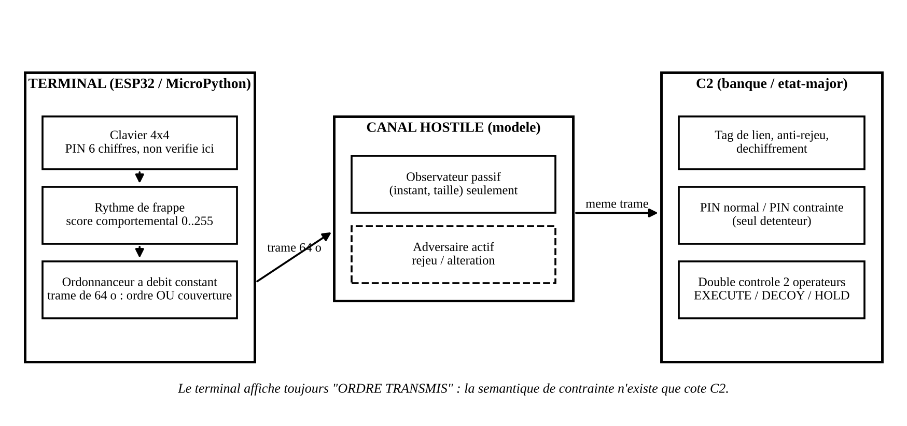
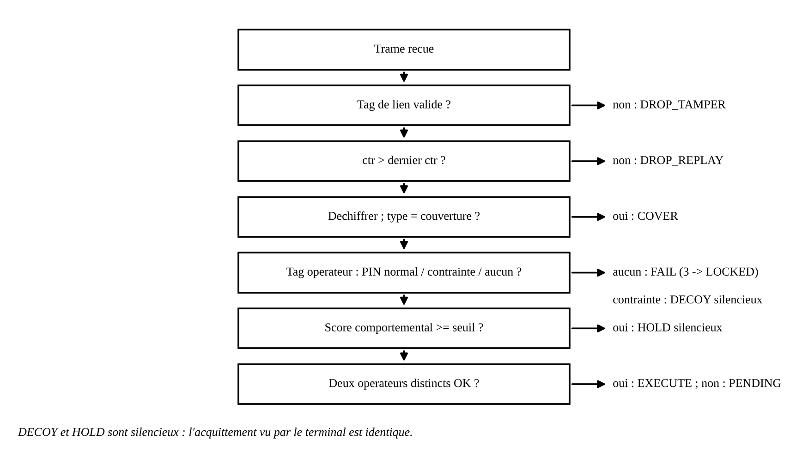

# Architecture

* `tcrypto.py` — HMAC-SHA256 on `hashlib.sha256` (checked against CPython `hmac`), PRF-CTR keystream.
* `tproto.py` — `Terminal` (emits exactly one 64-byte frame per slot), `C2` (verification and decision).
* `tbio.py` — typing-rhythm profile: mean and coefficient of variation of inter-key intervals; score 0..255.
* `tchannel.py` — link model, observer, replay/tamper helpers.
* `tscen.py` — six reproducible scenarios, scripted operator (integer LCG, same bytes on PC and ESP32).
* `main.py` — hardware: keypad scan, SSD1306 over I2C, two LEDs, serial keypad mirror (`select.poll`).

**Frame** (64 B): `ctr(4) | ct(48) | link_tag(12)`; clear text `type | op | cmd | action | param | bio | op_tag(16) | pad(22)`.
`op_tag = HMAC(HMAC(Kmac, "OP"|op|PIN), ctr|body)[:16]`: the terminal derives it from whatever PIN was typed;
only the C2 can check it against the normal and the duress PIN.

**Decision order at the C2**: link tag → counter → cover → operator tag (normal / duress / none) →
behavioural score → two-person rule. `DECOY` (duress) dominates `HOLD` (rhythm); one poisoned frame poisons
the whole command whichever operator came first. The downlink acknowledgement has one shape for every outcome.

**MicroPython choices**: `machine.Pin/I2C`, `framebuf`, `hashlib`, `select.poll`, `time.ticks_*`, `os.urandom`.
`cryptolib` was not needed. Floats on ESP32 are 32-bit: the integer LCG keeps device and host timings identical.
