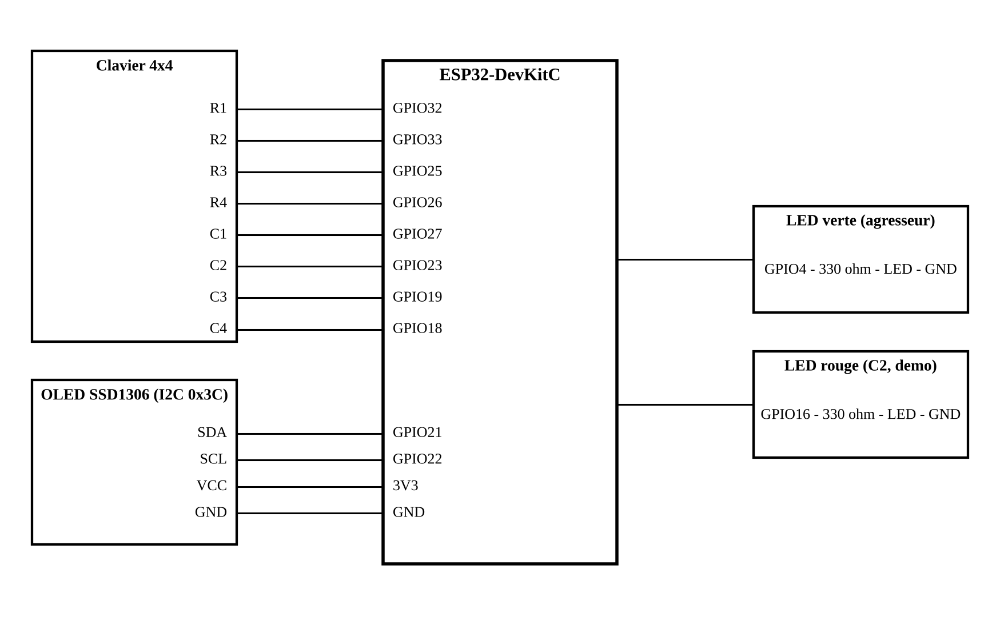

# Wiring (ESP32-DevKitC → parts)

| Part pin | ESP32 | Part pin | ESP32 |
|---|---|---|---|
| Keypad R1..R4 | GPIO 32, 33, 25, 26 | OLED SDA / SCL | GPIO 21 / 22 |
| Keypad C1..C4 | GPIO 27, 23, 19, 18 | OLED VCC / GND | 3V3 / GND |
| LED green (330 Ω) | GPIO 4 | LED red (330 Ω) | GPIO 16 |

No strapping pin (0, 2, 12, 15) is used for inputs. Pin names `R1..R4, C1..C4, SDA, SCL, VCC, GND, A, C`
match the Wokwi parts used in `wokwi/diagram.json` (the diagram loaded and ran).
